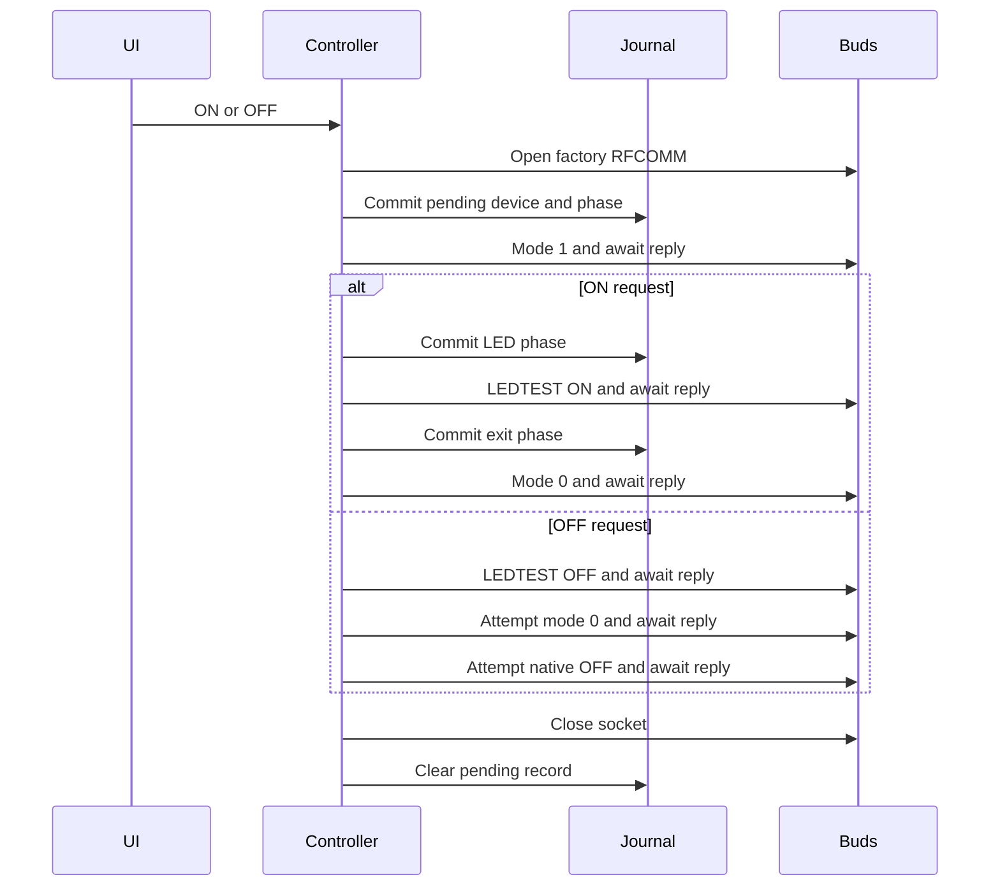

# Architecture

[README](../README.md) · [Protocol](protocol.md) · [Validation](validation.md)

BladeLight uses short-lived factory RFCOMM sessions for light control and saved-style settings. It leaves no permanent socket or service running after a completed operation. ON produces steady diagnostic output; it does not start the normal Samsung pattern state machine or overwrite the saved style.

## Components

| Component | Responsibility |
| --- | --- |
| `MainActivity` | Device selection, light commands, theme, permissions and recovery UI |
| `BladeSheet` / `BladeIcon` / `BladeArtworkView` | Themed choices, interface icons and signature rendering |
| `BladeController` | Process-wide owner, serialized worker, connection and exchange deadlines |
| `RecoveryTransaction` | Android-independent light transaction and recovery policy |
| `PatternSettings` / `PatternTransaction` | Guarded style snapshots, writes and readback |
| `Protocol` | Framing, CRC, stream decoding and reply matching |
| `StateStore` | Registration, recovery journal and connection epochs |
| `AutoConnectReceiver` | Filters ACL events for the registered bonded Classic device |
| `AutoLightService` | Brief foreground work on a qualifying connection |

Source: [application package](../app/src/main/java/dev/bladelight/app/).

## Command lifecycle

The controller admits one operation at a time. Registration cannot change during an operation or while recovery is pending. It is checked again when writing the journal. The response ticket is armed before the packet is written so an immediate response cannot be missed.

| Stage | Deadline |
| --- | --- |
| Connect | 10 seconds |
| Write and flush | 2 seconds |
| Matching response | 3 seconds |

Connection and write deadlines close the socket. These are per-stage bounds, not a promise that the entire transaction finishes in ten seconds. A recovery session has its own bounded stages.

## Recovery and acknowledgement ambiguity

The pending record is synchronously committed before the first device command. A failed commit prevents device-side effects. The device address and phase remain available if the process disappears mid-operation.

An interrupted socket is discarded. One recovery attempt opens a **fresh session**, enters diagnostic mode, requests LED OFF, attempts mode exit and sends native OFF. Both exit and native OFF are attempted even if an earlier cleanup step fails. Only successful required steps clear the journal; otherwise it remains for app resume or a subsequent real connection.

This matters because LED ON and OFF have the same textual acknowledgement and no request sequence number. Reusing the failed socket could mistake a delayed ON reply for an OFF reply. A fresh session removes that ambiguity from the previous transport session, but the reply still does not measure physical light output.

Production uses `RecoveryTransaction`. Historical bounded trial helpers in `Protocol` are covered by tests but are not the daily controller's transaction implementation. In particular, production does not apply their same-session mode-exit retry policy.

## Saved style changes

The controller serializes style operations with light control. A fresh supported revision-4 snapshot supplies the existing touch settings and saved style. The compound write preserves those settings and rejects configurations whose normalization has not been validated. A durable pending record is committed before a write; a new connection provides settings readback. After interruption, reconciliation reads the current settings without replaying or rolling back the style command. An unreadable outcome remains pending.

The saved setting is distinct from the active native scene and from diagnostic output. A successful settings readback does not establish a physical light change or start a cold native pattern.

Lighting and settings journals are independent. Explicit OFF remains available when settings readback is pending or unsupported. If both journals are present, lighting cleanup runs before settings reconciliation, including the automatic-ON path. Merely opening the style picker does not consume an automatic-ON connection epoch.

## Automatic operation

Auto-on is initially disabled, and selecting a new device resets it. A qualifying event must match the registered address, an existing bond and Classic Bluetooth transport. LE-only duplicate entries are excluded from selection.

The persisted connection epoch is claimed once per connection. Immediate duplicate connection events are suppressed; a later genuine connection can create a new epoch even when a disconnect event was missed. A manual operation takes priority over auto-on. Pending recovery is retained and can run even while auto-on is disabled.

The foreground service waits one second for services to settle. If the controller is occupied, it checks at 250 ms intervals within a 30-second waiting window, then stops. These are temporary coordination waits, not a permanent polling service. There is no boot receiver or keepalive connection.

Disabling auto-on does not extinguish an existing light. An explicit OFF request is not cancelled by an auto-option change. Force-stop is different from ordinary process death: the user must reopen the app after force-stop before automatic operation can resume. See Android's [stopped-state behavior](https://developer.android.com/about/versions/15/behavior-changes-all#enhanced-stop-states) and [connected-device foreground service documentation](https://developer.android.com/develop/background-work/services/fgs/service-types#connected-device).

## Presentation and local data

English is the default resource language; Korean is supplied separately. Android 13+ can select either per app. On Android 12 the system language determines the resource choice. Theme selection is stored independently. The signature remains decorative: the app has no reliable physical LED-state query.

Private preferences store the selected Bluetooth address/name, theme, automatic-operation state, connection bookkeeping and pending recovery, including a pending settings reconciliation. Diagnostic logs use Android logcat. Android backup is disabled and no Internet permission is declared. There is no account or remote telemetry service.

Bluetooth connection/scan permissions support device access; a connected-device foreground service and notification permission support brief automatic work. The name-based Buds3 Pro selector is a usability filter, not cryptographic model identification. The application must not imply compatibility merely because a device has a matching name.
